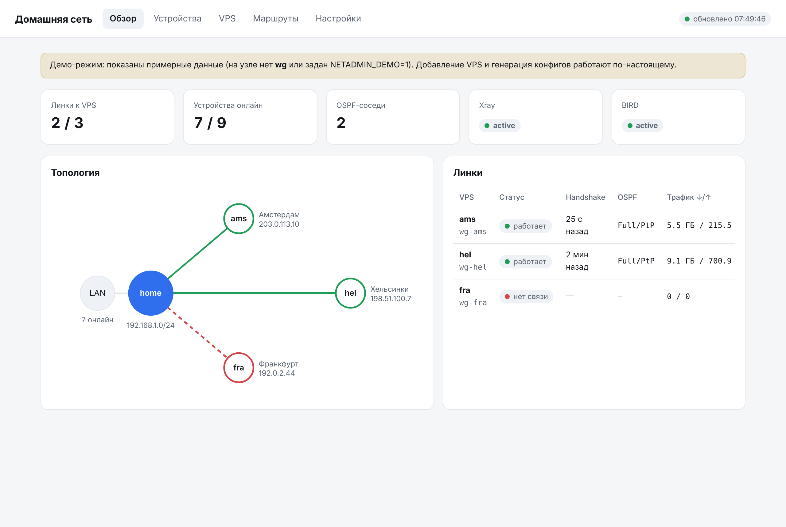

# netadmin: админка домашней сети



Веб-панель для схемы **Xray (VLESS+REALITY) → WireGuard → BIRD/OSPF**:
дом подключается к одному или нескольким VPS, по туннелям крутится OSPF, а VPS служат точками входа
для телефона и ноутбука снаружи.

Что умеет:
- **Обзор**: топология, статус каждого линка (handshake WireGuard + состояние OSPF-соседа), трафик, статус Xray и BIRD.
- **Устройства**: все устройства домашней LAN (`ip neigh` + DHCP-аренды dnsmasq/OpenWrt), поиск.
- **VPS**: добавление VPS одной формой. Админка сама выделяет адреса (/31 на линк, router id, локальный порт Xray),
  генерирует ключи WireGuard, ключи REALITY и UUID, собирает конфиги и `bootstrap.sh`.
  Развёртывание на VPS кнопкой по SSH, ссылка `vless://` для телефона, удаление.
- **Маршруты**: OSPF-соседи и таблица BIRD.
- **Применить дома**: генерирует и (при `NETADMIN_APPLY=1`) выполняет `apply.sh`, который поднимает `wg-<имя>`
  на каждый VPS, пишет клиент Xray и `bird.conf`, удаляет линки удалённых VPS.

Зависимостей нет: только Python 3.9+ из стандартной библиотеки.

## Как устроена сеть

```
телефон ──VLESS──▶ VPS ams ─┐                         ┌─ gpu-pc 192.168.1.10
                            │ WG wg-home 10.255.0.0/31 │
                 Xray (UDP поверх VLESS+REALITY, 443/tcp)
                            │                         │
                         домашний узел ── br-lan ─────┴─ nas, принтер…
                            │ OSPF area 0 по всем wg-*
телефон ──VLESS──▶ VPS hel ─┘
```

- Дом: на каждый VPS отдельный интерфейс `wg-<имя>` (`Table = off`, `AllowedIPs = 0.0.0.0/0`),
  Endpoint `127.0.0.1:2000N` указывает на локальный `dokodemo-door` Xray, который везёт UDP до VPS.
- VPS: Xray принимает VLESS+REALITY на 443 и отдаёт UDP в локальный WireGuard (51820). Снаружи порт 51820
  закрыт nftables. Пользователь `link@home` может ходить только в 127.0.0.1:51820/udp.
- BIRD принимает только частные сети (`10/8`, `172.16/12`, `192.168/16`), поэтому default и публичные адреса VPS
  никогда не уходят в туннель (нет петли).
- Телефон подключается к любому VPS как обычный VLESS-клиент: интернет идёт через VPS, а домашняя
  `192.168.1.0/24` доступна через туннель, потому что VPS выучил её по OSPF.

## Установка одной командой

На всегда включённом Linux-узле дома (Debian/Ubuntu, Fedora, Arch; нужен systemd):

```bash
curl -fsSL https://raw.githubusercontent.com/obotkov/home-net/main/install.sh | sudo bash
```

Скрипт ставит `python3`, `wireguard-tools`, `bird2`, скачивает проект в `/opt/netadmin`, сам определяет
LAN-интерфейс и подсеть, генерирует пароль, создаёт SSH-ключ для деплоя VPS и запускает сервис `netadmin`.
В конце печатает адрес панели, пароль и публичный SSH-ключ.

- **Обновление**: та же команда. Код заменяется, состояние и ключи в `/var/lib/netadmin` не трогаются.
- **Настройки**: `/etc/netadmin.env`, затем `sudo systemctl restart netadmin`.
- **Удаление**: `curl -fsSL https://raw.githubusercontent.com/obotkov/home-net/main/install.sh | sudo bash -s -- --uninstall`
- **Приватный репозиторий**: raw-ссылка без токена не откроется. Либо сделайте репозиторий публичным
  (секретов в коде нет, все ключи создаются на узле), либо скопируйте `install.sh` на узел и запустите с токеном
  (fine-grained, право Contents: read): `sudo NETADMIN_GITHUB_TOKEN=github_pat_... bash install.sh`

### Домен и HTTPS (Let's Encrypt)

Панель можно повесить на домен с настоящим сертификатом. Перед ней ставится [Caddy](https://caddyserver.com):
он сам получает сертификат Let's Encrypt и сам его продлевает (примерно за 30 дней до истечения), cron не нужен.
Сама панель после этого слушает только `127.0.0.1:8088`.

Ничего дописывать в команду не нужно: во время установки скрипт сам спросит в терминале.

```
Домен панели (Enter — без домена): panel.example.com
Email для Let's Encrypt (придут предупреждения об истечении): me@example.com

 Как Let's Encrypt проверит, что домен ваш:
   1) http       — у узла белый IP, порты 80 и 443 проброшены на него
   2) cloudflare — через DNS Cloudflare: порты не нужны, работает за CGNAT
Способ (1/2) [1]: 2
API-токен Cloudflare (ввод скрыт):
  токен действителен

 Кому открыть панель по домену:
   1) только из домашней сети и VPN (рекомендуется; остальным 403)
   2) всем в интернете (защищает только пароль)
Доступ [1]:

 Итог: https://panel.example.com · проверка: cloudflare · доступ: LAN/VPN · me@example.com
Продолжить установку? (Y/n) [Y]:
```

При повторном запуске (обновлении) в скобках стоят текущие значения, Enter их оставляет, `-` в вопросе
про домен убирает его. Для автоматизации без вопросов есть флаги `--domain`, `--email`, `--acme`, `--cf-token`,
`--allow`, `--no-domain` (см. начало `install.sh`) или `NETADMIN_NONINTERACTIVE=1`.

Токен Cloudflare: My Profile → API Tokens → Create Token → шаблон «Edit zone DNS», зона вашего домена.
Запись в Cloudflare должна быть «DNS only» (серое облако). Для DNS-проверки скрипт скачивает сборку Caddy
с модулем Cloudflare с caddyserver.com и подключает её через drop-in, системный пакет не трогает.

**Кто видит панель.** По умолчанию (`--allow private`) Caddy пускает только частные адреса: LAN, VPN-туннели,
CGNAT-диапазон. Остальным отвечает 403, а получение и продление сертификата при этом работает.
Вариант «всем» открывает панель в интернет (тогда защищает только пароль); свой список сетей задаётся флагом `--allow "192.168.1.0/24 10.255.0.0/16"`.
Удобнее всего вариант 2 с A-записью на LAN-адрес: из дома и через VPN панель открывается по `https://домен`, а из интернета её не видно вовсе.

Домен запоминается в `/etc/netadmin.env`. Проблемы с сертификатом: `journalctl -u caddy -n 50`.

Для кнопки «Развернуть по SSH» добавьте напечатанный ключ на VPS:
`sudo ssh-copy-id -i /root/.ssh/id_ed25519 root@<vps>`. Без этого скачайте `bootstrap.sh` в карточке VPS
и запустите вручную: `ssh root@<vps> 'bash -s' < bootstrap-ams.sh`.

## Порядок добавления VPS

1. VPS → заполнить форму → «Добавить».
2. «Развернуть по SSH» (ставит wireguard-tools, bird2, nftables, Xray, пишет конфиги, включает сервисы).
3. «Применить дома».
4. Через минуту линк зелёный, сосед OSPF в состоянии `Full/PtP`.

## Безопасность

- Панель слушает только указанный адрес. Не открывайте её в интернет: заходите из LAN или через VPN.
- `state.json` содержит приватные ключи, права 600. Делайте его резервную копию.
- Вход по Basic-auth, изменяющие запросы защищены от CSRF заголовком.
- Деплой перезаписывает `/etc/bird/bird.conf` и `/usr/local/etc/xray/config.json` на VPS: используйте чистые VPS.

## Переменные окружения

| Переменная | По умолчанию | Назначение |
|---|---|---|
| `NETADMIN_LISTEN` | `127.0.0.1:8088` | адрес панели |
| `NETADMIN_PASSWORD` | случайный, печатается в лог | пароль `admin` |
| `NETADMIN_STATE` | `./netadmin-state.json` | состояние и ключи |
| `NETADMIN_OUT` | `./out` | куда писать сгенерированные файлы |
| `NETADMIN_APPLY` | выкл | `1` = «Применить дома» выполняет `apply.sh` (нужен root) |
| `NETADMIN_DEMO` | выкл | `1` = демо-данные |

Попробовать без сети: `NETADMIN_DEMO=1 NETADMIN_PASSWORD=test python3 -m netadmin` → http://127.0.0.1:8088

Тесты парсеров: `python3 -m unittest discover tests`
